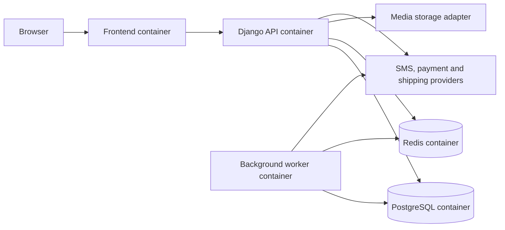

# Architecture decision — containerized Django marketplace

Status: accepted direction; implementation details remain in progress.

## Development topology

Docker Compose will run separate `frontend`, `api`, `worker`, `db`, and `redis` services. An optional scheduler service may be added when recurring jobs exist. Compose is the local and test-environment interface; production orchestration and hosting are separate deployment decisions.

## Application choices

- **Backend:** Django with Django REST Framework for the versioned HTTP API. Start as a modular monolith so catalog, commerce, payments, identity and operations have explicit boundaries without cross-service transactions.
- **Database:** PostgreSQL is the source of truth for products, offers, inventory, orders, payments and audit records. Migrations are versioned with code.
- **Cache and queue:** Redis supports cache, rate limits and the background-job broker. Durable business state remains in PostgreSQL.
- **Worker:** Celery runs notifications, media processing, reconciliation and timeout jobs. Tasks are idempotent and retryable.
- **Frontend:** A separate Next.js TypeScript service renders Persian RTL buyer, seller and admin surfaces. Public catalog pages can be server-rendered. The first page is a responsive landing shell; business features remain to be built.
- **Media:** Local development storage behind an adapter; production object storage is selected before launch. Direct upload and scan rules are required for seller media.
- **Integrations:** Each payment, SMS and shipping provider is behind an adapter with its own configuration, callback verification and test suite. No provider secret enters browser code or Git.

## Backend modules

| Module | Owns |
| --- | --- |
| `accounts` | Users, profiles, phone verification, sessions, roles and permissions |
| `catalog` | Categories, brands, products, variants, attributes, media and moderation |
| `sellers` | Seller applications, store profiles, staff membership and commissions |
| `offers` | Seller offers, warranties, availability and inventory |
| `checkout` | Carts, quotes, discounts, addresses, delivery choices and reservations |
| `orders` | Immutable order lines, order lifecycle, shipments and returns |
| `payments` | Attempts, provider adapters, verification, refunds and ledger |
| `operations` | Admin actions, audit, support, content, campaigns and reports |

Module ownership is a code organization rule. Cross-module operations such as checkout run in a database transaction and expose application services rather than updating another module's tables from views.

## Payment boundary

The API creates a local payment attempt and calls the selected provider adapter. The browser visits the provider's authorized flow. The callback or browser return triggers server-side provider verification. Only a verified amount and reference can transition the order to paid. Duplicate and reordered callbacks are safe. A reconciliation job resolves interrupted attempts. Provider-specific eligibility, refunds, split tender and settlement rules are accepted only from current signed documentation.

## Security and operations

- Staff authorization is checked by Django on each request; hiding a frontend control is not authorization.
- Privileged staff accounts require stronger authentication and audited access. No superuser account is used for routine operations.
- Database and Redis ports stay on the internal Compose network in normal operation.
- Health checks, structured logs, tracing identifiers, error reporting, backups and restore rehearsal are part of the foundation and launch milestones.
- Development credentials live in ignored local environment files; example files contain placeholders only.

## Decisions still requiring a business owner

Hosting region/provider, public domain, merchant of record, payment contracts and callback requirements, launch categories, shipping contracts, SMS provider, object storage provider, commission and settlement policy, legal documents and tax/invoice treatment. The service boundaries allow implementation of core catalog and UI while these are resolved.
