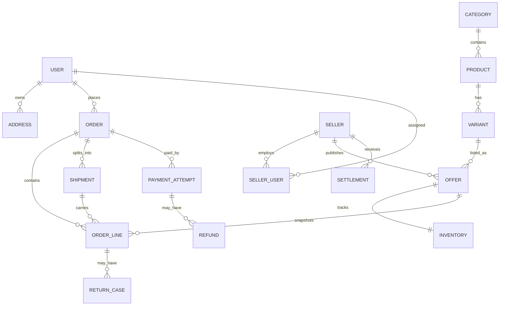

# Domain model and invariants

Status: design draft for Milestone 1.

## Main relationships

## Entity notes

- **Product** is canonical shared content. **Variant** is a purchasable configuration such as color and capacity. Neither owns the current selling price.
- **Offer** belongs to one seller and one variant. It owns price, warranty, fulfillment mode and publication status. Several offers can reference the same variant.
- **Inventory** tracks available, reserved and committed quantities for an offer and location. Reservation and release happen atomically.
- **Order line** snapshots title, variant attributes, seller, price, discount, warranty, tax/fees and chosen fulfillment promises. Later offer edits cannot rewrite a placed order.
- **Shipment** groups order lines by fulfillment source and delivery promise. One order can have several shipments and independently changing delivery states.
- **Payment attempt** records each provider attempt. One order can have several failed attempts but only the verified captured total can be credited to the order.
- **Ledger entry** records financial movements; payment captures, refunds, commissions and seller payables are separate entries, never a single mutable balance field.
- **Return case** attaches to an order line and quantity; it progresses through eligibility, approval, receipt, inspection and refund states.

## State transitions

| Object | Allowed main path | Important exceptions |
| --- | --- | --- |
| Seller | applied → under_review → approved | rejected, suspended |
| Product proposal | draft → submitted → approved → published | changes_requested, rejected, archived |
| Offer | draft → pending_review → active | paused, out_of_stock, rejected, archived |
| Order | pending_payment → paid → fulfilling → complete | payment_expired, partially_cancelled, cancelled, return_in_progress |
| Payment attempt | created → redirected → verifying → captured | rejected, expired, verification_failed, refunded/partially_refunded |
| Shipment | pending → preparing → dispatched → delivered | cancelled, delivery_failed, returned |
| Return case | requested → approved → in_transit → inspected → refunded | rejected, closed_without_refund |

## Critical invariants

1. Available inventory never falls below zero; one unit cannot be committed to two orders.
2. Order totals equal the sum of immutable line, discount, delivery and fee snapshots in one documented currency unit.
3. Duplicate or reordered provider callbacks cannot create a second capture, order or refund.
4. A refund's cumulative amount cannot exceed the verified captured amount, nor the refundable amount of its order lines.
5. Seller users can access only their seller's offers, order lines and reports. Admin permissions are checked server-side for every action.
6. Every admin action affecting prices, commissions, seller status, refunds, provider settings or roles creates an audit record.
7. Seller settlement derives from ledger entries and can be held or adjusted without rewriting prior transactions.

## Initial API boundaries

- Catalog: categories, products, variants, media and seller offers.
- Identity: users, phone verification, staff authentication and sessions.
- Commerce: carts, quotes, inventory reservations, orders and shipments.
- Payments: provider adapters, payment attempts, verification, refunds and reconciliation.
- Operations: seller onboarding, admin moderation, audit trail, campaigns and support.

Start as a modular application with clear boundaries. Separate services only after measured scale or team ownership requires them.
